<!-- _class: title -->
<!-- header:  -->
<!-- _class: centered -->

# 画面の滑らかさの裏側 DevToolsから考える Flutterアプリのバッテリー消費と最適化

### Behind Smooth Scrolling: Evaluating Flutter App Battery Consumption via DevTools

anushka・opheliagame・アン

---

<!-- _class: intro -->
<!-- header: 自己紹介 -->

  <ul>
    <li>インド出身</li>
    <li>Flutter 5年目</li>
    <li>teamLab チームラボ 2年目</li>
    <li>Creative Coding #p5.js</li>
    <li>Live Coding #hydra #glsl</li>
    <li>モノづくり 木工初心者</li>
  </ul>

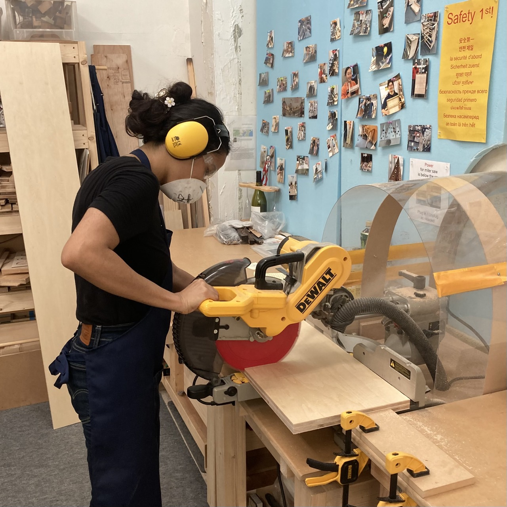

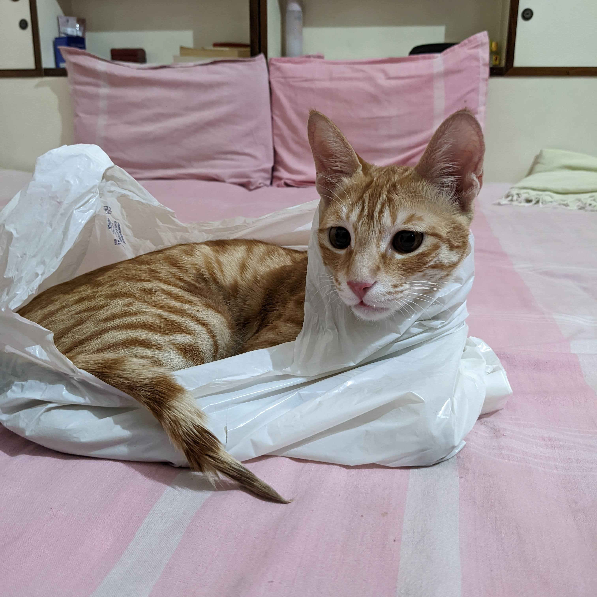

<!-- 
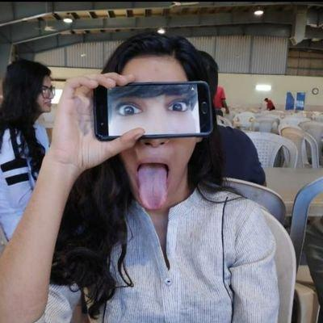
 -->
<!-- 
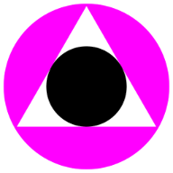
 -->

---

<!-- header: 背景 -->

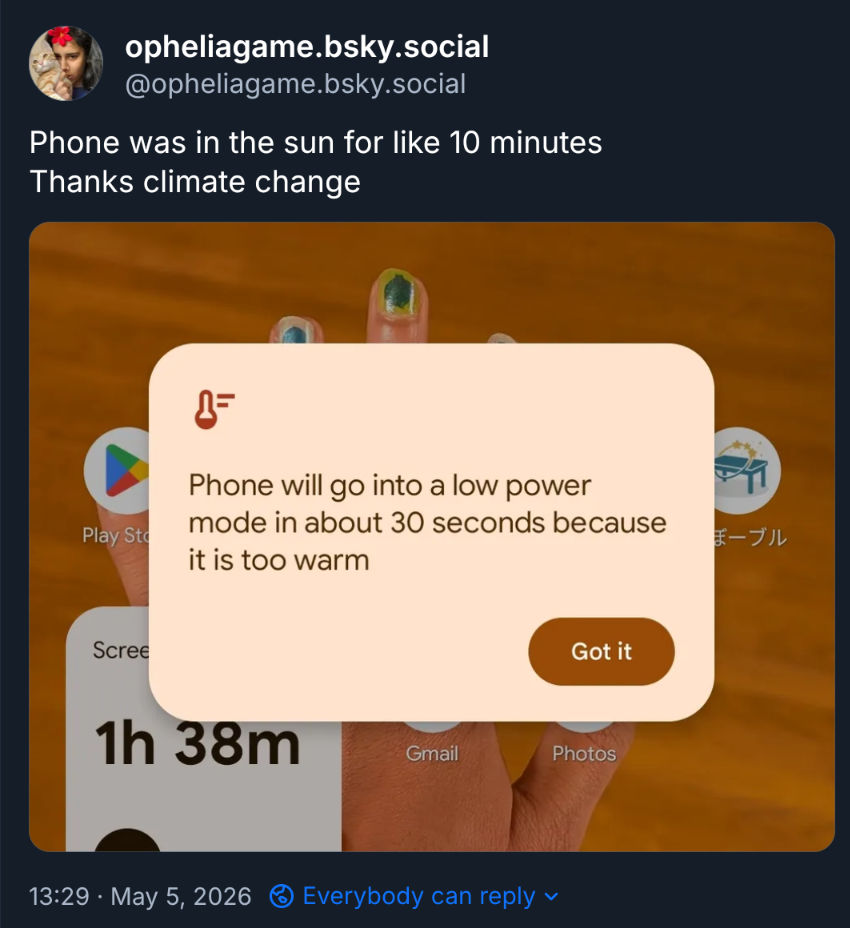

---

<!-- header: 背景：BackdropFilter -->

[API Reference: BackdropFilter](https://api.flutter.dev/flutter/widgets/BackdropFilter-class.html)

---

<!-- _class: article-reference -->
<!-- _class: centered -->

<!-- header: 調査：Liquid Glass + Flutter、Jaxon Evansさんの記事 -->
<!--

  

 -->

<a href="https://medium.com/@jaxonevans/liquid-glass-in-flutter-066fb3615e6f">Liquid Glass in Flutter, Jaxon Evans on Medium</a>

---

<!-- _class: image-triplet -->
<!-- header: 計測に使用したアプリ：BoostBlue @JaxonEvansさんありがとう！ -->

  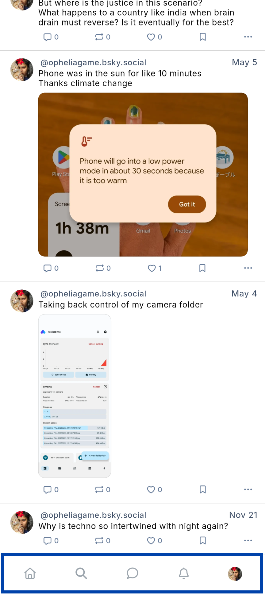
  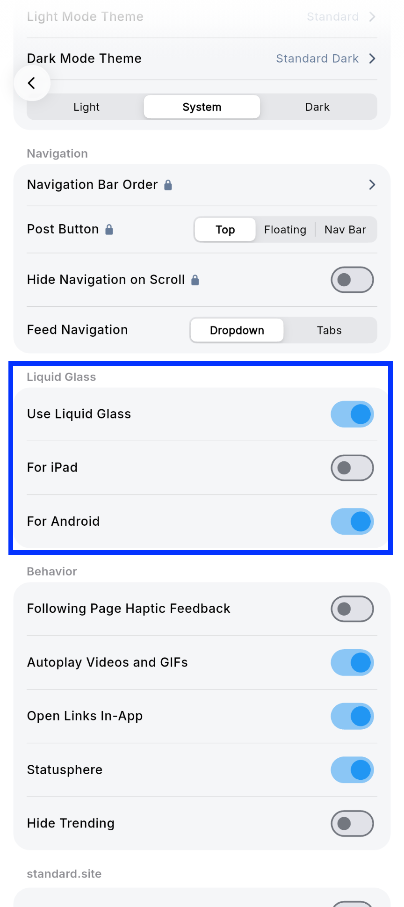
  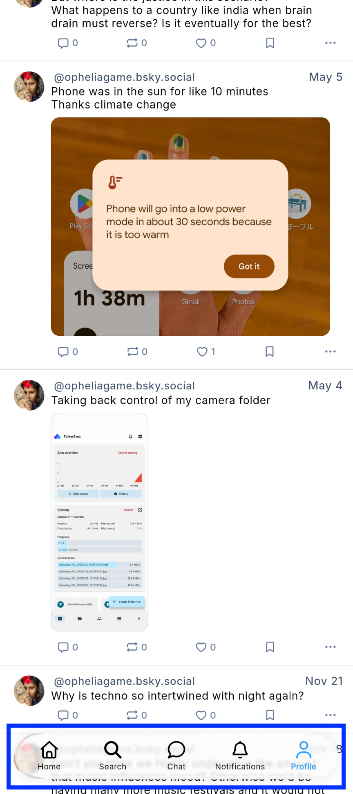

---

<!-- _class: image-pair -->
<!-- header: 背景：Performance -->

<!-- 

  
  

[Building performant Flutter widgets](https://flutter.dev/blog/building-performant-flutter-widgets)

--- -->

<!-- header: 調査：Liquid Glass + BackdropFilter -->
<!-- _class: centered -->

# Liquid Glassのぼかしを実装するために使う

# 画面全体のBackdropFilterは

# パーフォマンスにどれぐらい影響あるのでしょうか？

---

<!-- header: アプリのエネルギー使用をどうやって測るのか -->
<!-- _class: centered -->

# Flutterだけだとみれる項目が限定され、

# Nativeのツールの方がより正確

---

<!-- header: Android Performance Analyzer -->

---

<!-- header: Android Performance Analyzer: トレーステストを開始 -->

---

<!-- header: Android Performance Analyzer: トレーステストを開始 -->

---

<!-- header: Android Performance Analyzer: トレーステストを開始 -->

---

<!-- header: Android Performance Analyzer: トレーステスト結果 -->

---

<!-- header: Android Performance Analyzer: トレーステスト結果 -->

---

<!-- header: Android Performance Analyzer: トレーステスト結果 -->

---

<!-- header: Android Performance Analyzer: Android Profiler Skills -->
<!-- _class: image-pair -->

`$ android skills add android-profiler`

  
  

[Android Profiler: AI-powered analysis](https://developer.android.com/android-performance-analyzer/analyze/ai#ai-analysis)

---

<!-- _class: chart -->

<!-- header: 計測結果：ぼかし（FlutterでLiquid Glass実装）・エネルギー -->
<!-- _class: centered energy-result -->

# Liquid Glass利用アプリは

# エネルギー消費量が

# `28%増加`

---

<!-- _class: chart -->
<!-- _class: centered -->
<!-- header: 計測結果：エネルギー -->

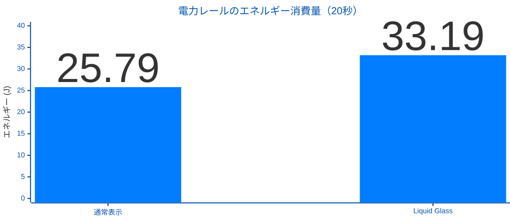

20秒間の電力レールエネルギー：通常表示 25.79 J → Liquid Glass 33.19 J（+28.7%）

---

<!-- _class: chart -->
<!-- _class: centered -->
<!-- header: 計測結果：CPU・GPU活動 -->

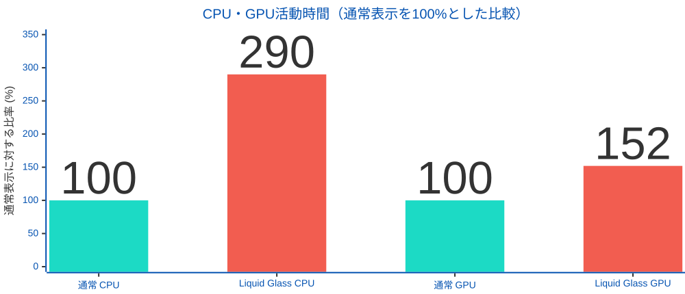

計測区間：CPU 2.265 → 6.576 CPU秒/5秒、GPU 1.691 → 2.567秒/5秒

---

<!-- header:  -->
<!-- _class: centered -->

# なぜこのような結果になったのでしょうか

---

<!-- _class: left -->
<!-- header: Widgetの裏側：BackdropFilter -->

画面を描画するとき、`RenderBackdropFilter` はGPUで動かすのは

## 1. 今の画面の背景をコピーして、別の場所に保存する

## 2. その背景にぼかしの計算をする

## 3. ぼかした画像を、もう一度メインの画面に合成する

## フレームごとに実行、1秒間に60回から120回

---

<!-- header: BoostBlueが使っているパッケージ「liquid_glass_widgets」のドキュメントを確認 -->
<!-- _class: image-pair -->

  
  

---

<!-- header: BackdropFilterとエネルギー消費 -->
<!-- _class: centered -->

## 「この処理は比較的コストが高い特に、`ぼかしのように、フィルタが非局所的である場合はなおさらである`」

# +

## `画面全体ぼかし`、いわゆるLiquidGlass実装

# =

## エネルギー消費量増加

# なるほど！

---

<!-- header: まとめ -->

## エネルギー消費量を実際に測る手順・ツールとして、Android Performance Analyzerと、Xcode Energy Logを用いることができる

## BackdropFilterなど、エネルギー消費量の多いWidgetに注意が必要

## 最終的にはパフォーマンスとデザインのトレードオフになる

## 計測することでトレードオフによるチーム判断の資料として、役に立つ

---

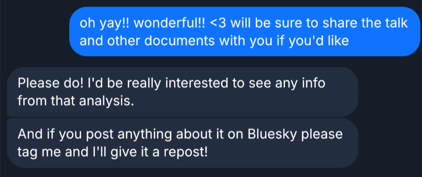

---

<!-- _class: qr -->
<!-- header:  -->
<!-- _class: centered -->

Jaxon EvansさんとBoost Blueさんもありがとう！

`X @oopheliagame`  
`Github @opheliagame`
`anushka@team-lab.com`

