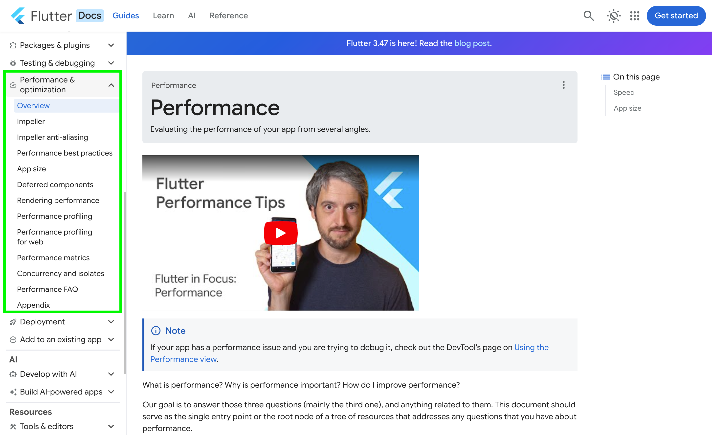
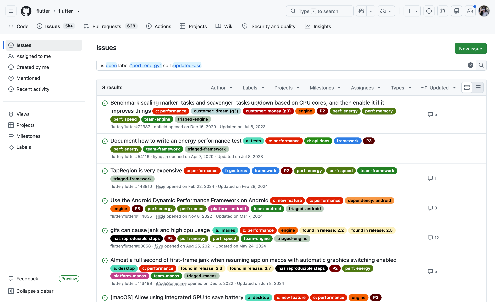

# 261026 Reveal.js Presentation Notes

対象: `261026-滑らかさは省電力ではない.html`

# When thinking about performance in flutter, the first page you might open is below

Flutterはパーフォマンスを考える時は初めに辿り着くのが以下でしょう
https://docs.flutter.dev/perf

# パーフォマンスは何（質問が深いから飛ばす）

そこに書いているのが

Finally, the performance issues are divided into four categories. They correspond to the four labels that are used in the Flutter GitHub issue database: "perf: speed", "perf: memory", "perf: app size", "perf: energy".

# 今回は"perf: energy"について話します

https://github.com/flutter/flutter/issues?q=is%3Aopen+label%3A%22perf%3A+energy%22+sort%3Aupdated-asc+

↑は本当に色々な話があるので、後で見てみてください！

# みなさんお分かりのがDevToolsのPerformanceですよね

https://docs.flutter.dev/tools/devtools/performance

---

# but we CANNOT see energy related stats using DevTools

to be confirmed and get link for

> The official Flutter recommended workflow for battery auditing is to launch the Flutter runner directly inside Xcode or Android Studio to run native energy trace sessions against release/profile builds.

## iOS / macOS - XCode Energy Log

## Android Ecosystem

- Android Studio's Power Profiler (previously Energy Profiler)
  https://developer.android.com/studio/profile/power-profiler

- Batterystats via adb

- Battery Historian (not actively maintained)
  https://github.com/google/battery-historian

- Perfetto
  https://perfetto.dev/

## Android Tools

PowDroid
https://hal.science/hal-03380605v1
batterystats

E-MANAFA
https://dl.acm.org/doi/epdf/10.1145/3551349.3561342
batterystats, perfetto and logcat

PETrA
batterystats

---

# Recent changes and work

## On-Device Power Rails Monitor (ODPM)

> This data source has been introduced in Android 10 (Q) and requires the dedicated hardware on the device. This hardware is not yet available on most production phones.
